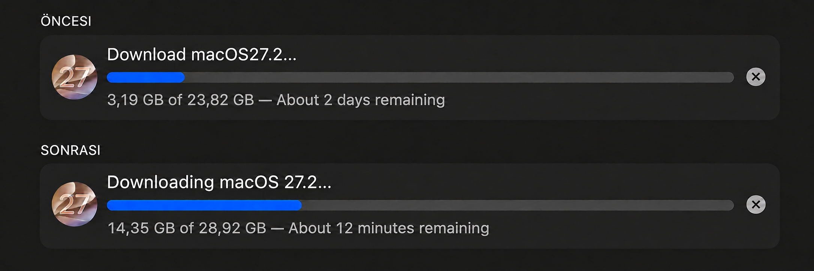

# Apple CDN Speedtest for macOS

[Türkçe](README.tr.md)

Compare Apple update CDN servers from your Mac. No Go, Python, AI tool or account is required. The script discovers IPv4/IPv6 addresses, performs bounded HTTPS downloads and prints optional hosts entries. It does not change system settings or install an update.

## Why this exists

On a 1 Gbit/s home connection, my Mac's update download showed about two days remaining. The downloader logs reported roughly 0.15 MB/s. After seeing a similar experience shared online, I investigated with Codex.

We queried different DNS resolvers for `updates.cdn-apple.com` and tested the same Apple update file against the returned IPv4 and IPv6 addresses. Short tests reached 51 to 78 MB/s on alternative endpoints. After changing the hosts entries and restarting the download, the displayed estimate was about 12 minutes.

I built this tool so other Mac users can run that discovery and comparison themselves, without Codex or another AI assistant. It measures candidates on your own connection instead of distributing a fixed IP as a universal fix.

### Before and after



*Edited comparison made from my screenshots: the before icon, title and progress bar were adjusted for presentation. The original screenshots show different update totals (23.82 GB and 28.92 GB). These are remaining-time estimates from separate download states, not a controlled same-file benchmark or the actual total installation time. Results vary by connection.*

## Start

1. Download with **Code > Download ZIP**, then extract the entire folder.
2. Double-click `start.command` and choose `en` or `tr`.
3. Read the data budget, confirm, and wait for results.

If Finder cannot launch the file, open Terminal in the extracted folder:

```bash
bash macos/speedtest.sh --lang en
```

Requires macOS, Bash 3.2+, `dig` and curl 8.4+. Check `curl --version`; older macOS releases may need a newer curl. Do not run the benchmark with `sudo`. Keep `macos` and `config` beside `start.command`.

## Find your current update URL

A URL for your actual update gives a more relevant comparison than a generic sample file.

1. Start the macOS update download in System Settings > General > Software Update.
2. While it is downloading, run:

```bash
bash macos/speedtest.sh --lang en --find-url --yes
```

3. The script reads the last hour of local `softwareupdated` logs and lists candidate Apple ZIP/PKG URLs. It excludes documentation and update-brain URLs. Prefer the `com_apple_MobileAsset_MacSoftwareUpdate` file matching your current download; SFR files are additional update components. Multiple or old URLs may appear. This does not automatically identify your current OS version.
4. Copy the relevant full URL and run:

```bash
bash macos/speedtest.sh --lang en --url 'PASTE_FULL_HTTPS_URL_HERE'
```

Some logs omit or redact URLs. If nothing is found, let the download run briefly and retry, or run without `--url` to use bundled samples. Log reading does not download data or change anything. Full logs remain local and are deleted from the script's temporary folder when it exits.

Only direct HTTPS file URLs on `updates.cdn-apple.com` and `swcdn.apple.com` are accepted. The URL's hostname is used for DNS discovery and hosts suggestions. The same URL and ranges are used for every candidate in a run.

## If a test URL stops working

`config/test-urls.txt` contains an ordered list of sample Apple payloads. These are test data, not installation recommendations.

Before the speed test, the script requests one byte from each URL until one passes TLS, HTTP 206, Content-Range and minimum-file-size checks. The per-URL probe timeout is five seconds. If the first URL is removed, the next usable one is selected automatically. Probes use normal name resolution, including any existing hosts entries.

If none works:

- Interactive mode asks you to paste another Apple HTTPS file URL.
- Use `--find-url` to inspect your current download, then pass its address with `--url`.
- Or download the latest project ZIP. Maintainers can refresh `config/test-urls.txt` without editing the script.

A failed probe can also indicate a network problem or stale hosts override, not necessarily a deleted file. Supplying `--url` tests only that URL; it does not silently fall back to a different file. No remote code or automatic project update is downloaded.

## DNS discovery

The system DNS plus **13 public resolver endpoints from 10 providers** are queried. Duplicate CDN IPs are removed. Provider names in the result identify where an address was first seen, not the IP owner or server location.

Providers: Cloudflare, Google, Quad9, OpenDNS, AdGuard, Control D, CleanBrowsing, DNS.SB, DNS.WATCH and DNSForge. Add or remove endpoints in `config/resolvers.txt`, one `Name IP` per line. An IPv4 resolver can return both IPv4 and IPv6 records.

The additional addresses are documented by [DNS.SB](https://dns.sb/guide/), [DNS.WATCH](https://dns.watch/) and [DNSForge](https://dnsforge.de/). More resolvers may return the same IPs and make discovery take longer. Unreachable resolvers are skipped.

This is not a complete CDN inventory. `dig` uses the default DNS configuration, which can differ from macOS scoped or VPN resolvers. Some networks block or intercept public DNS queries. Public resolvers receive the hostname, not the complete update URL.

## Measurements

- IPv4 and IPv6 candidates are interleaved, then capped at 16 in discovery order.
- Default: 3 rounds, 4 MiB per sample, 6 seconds per request and 2 seconds to connect. Candidate order rotates between rounds; each round uses the next range of the same file.
- Maximum benchmark body data at defaults: 192 MiB, plus tiny URL probes and protocol overhead. Failed transfers also consume data.
- curl user configuration, redirects and proxies are disabled. HTTPS certificate and hostname verification stay enabled. curl 8.4+ enforces the body size limit even if Range is ignored.
- Samples require HTTP 206 and the correct Content-Range. Complete samples must match the expected length. Timeouts count only when at least 256 KiB arrived with valid TLS and range metadata.
- Results show median MB/s including connection time. Only candidates passing every round qualify for hosts suggestions, with at most one winner per address family.

These are short tests, not a sustained line-speed guarantee. `--sample-mib 16` gives larger samples at a higher data cost. The tool verifies TLS and range metadata, not the full update package signature or byte-for-byte equality between servers.

## Options

| Option | Purpose | Default |
|---|---|---|
| `--lang en` or `--lang tr` | Language | en; interactive selection |
| `--find-url` | List local update URL candidates; exit | off |
| `--url URL` | Test a specific Apple file | bundled list |
| `--discover-only` | DNS only; no file probes/downloads | off |
| `--yes` | Skip interactive prompts | off |
| `--rounds 3` | Repetitions, 2..5 | 3 |
| `--sample-mib 4` | MiB per sample, 1..16 | 4 |
| `--max-candidates 16` | Candidate cap, 1..64 | 16 |
| `--timeout 6` | Seconds per sample, 2..15 | 6 |
| `--report results.tsv` | Save a TSV report without overwriting | no file |
| `--help` | Show usage | |

```bash
bash macos/speedtest.sh --lang en --discover-only --yes
bash macos/speedtest.sh --lang en --yes --report results.tsv
```

## Apply and undo

Applying results is optional. The script never changes hosts, DNS, IPv6 or certificates.

1. Back up `/etc/hosts`.
2. Open it with `sudo nano /etc/hosts`.
3. Replace old entries for the tested hostname with the suggested lines. Do not accumulate multiple IPv4 or IPv6 entries for the same hostname.
4. Save, then refresh caches:

```bash
sudo dscacheutil -flushcache
sudo killall -HUP mDNSResponder
```

5. Restart the download while it is still downloading. Do not interrupt preparation or installation.
6. After updating, remove the added lines and refresh caches again.

If one address family has no winner, the downloader may still use that family's normal DNS route. The tool does not disable IPv6. Existing connections may retain their previous destination.

This independent tool is not affiliated with Apple. IPs can change, and the same anycast IP can lead to different physical servers. No telemetry is sent by the script.
